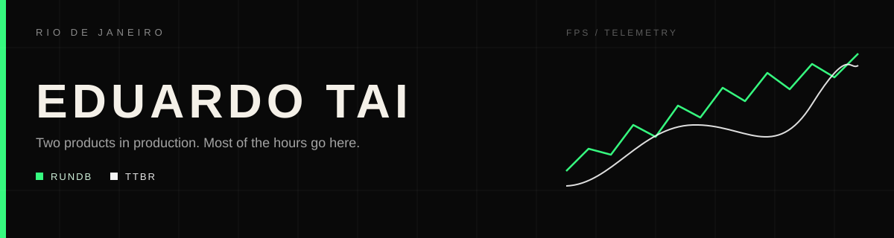
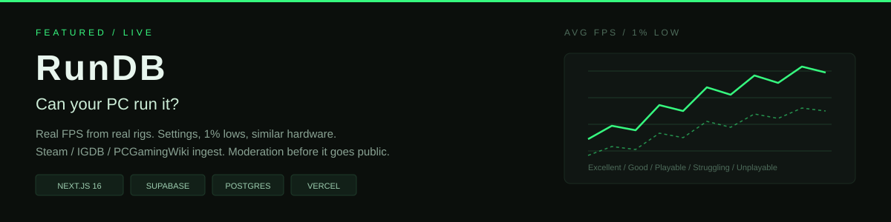
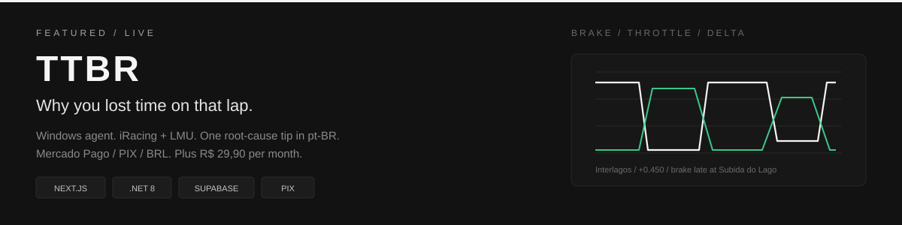
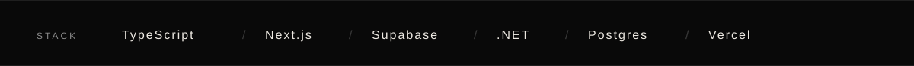

  

I ship from Rio. Two products take most of the hours.

This week that is **TTBR**, a sim racing coach for Brazil with a Windows agent, and **RunDB**, a community FPS database for real PC hardware.

 

  

  
  &nbsp;
  

Store-page minimum spec is marketing. RunDB answers the useful version. Can this machine run this game, at what settings, and what did similar CPUs and GPUs actually measure?

You save a rig (CPU, GPU, RAM, resolution). You browse a catalog ingested from Steam, IGDB, and PCGamingWiki. You read reports with average FPS, 1% lows, presets, tweaks, and a tier from Excellent down to Unplayable. New reports go through moderation before they hit public stats. Predictions get better as similar hardware shows up.

Next.js 16, React 19, TypeScript, Supabase, Postgres with RLS, Tailwind 4, shadcn/ui, Vercel.

 

  

  
  &nbsp;
  

A pretty delta graph does not tell you what to do on the next lap. TTBR does. A .NET 8 agent on Windows reads iRacing and Le Mans Ultimate from shared memory. After a session the web app shows traces, delta vs your best, and one root-cause tip in Portuguese.

Checkout is Mercado Pago. PIX and card. Prices in real, not dollars. Free is 20 sessions and 5 tips. Plus is R$ 29,90/mês, with a PIX promo on the first month and an optional 7-day trial that you opt into. The installer is a real `.exe`. The product copy is pt-BR because the pilots are.

Next.js, Supabase Auth, .NET desktop, Mercado Pago, Vercel.

 

  

TypeScript is the default. Next.js and Supabase for the web products. C# when the job is a tray agent talking to a sim. Postgres when the data has to survive. Vercel to ship.

 

## On the side

**[SetupForge](https://github.com/eduardotai/setupforge).** Verified sim racing setups plus a Portuguese AI coach. The ProtonDB idea, aimed at Brazilian grids. Older cousin of TTBR.

**AdvSystem.** Private practice OS for a Brazilian law firm. Offline-first PWA, clients and cases. Closed source on purpose.

**[Claude usage dashboard](https://github.com/eduardotai/claude-usage-dashboard).** Local token charts for Claude Code. FastAPI + SvelteKit. Nothing leaves the machine.

**[Penduricalho](https://penduricalho.vercel.app).** A Matter.js pendulum clicker. I wanted a physics toy, not another form.

 

## Elsewhere

I also stream and post.

  
  
  
  
  

